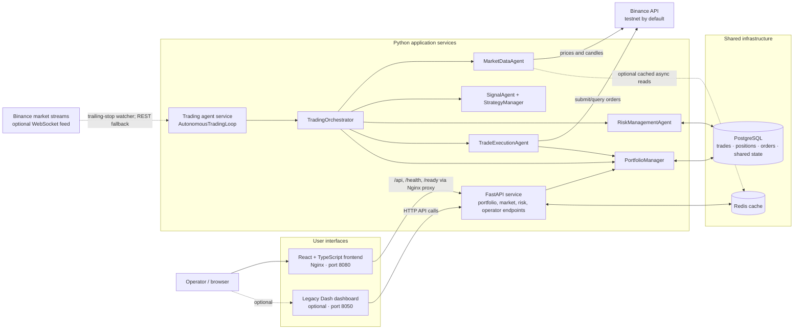

# Application Architecture

This page describes the main runtime components and the path from market data to a trade. The diagrams reflect the Docker Compose deployment; the legacy Dash dashboard is shown as optional.

## Runtime components



The React frontend is the recommended UI. Nginx serves the compiled single-page app and proxies API and health routes to FastAPI. The API provides read/control endpoints, while the separate trading-agent process runs the autonomous loop; both share persistent state through PostgreSQL. Redis backs API response caching, and the trading process can use market streams for quicker trailing-stop checks, with periodic REST checks as a fallback.

## One autonomous trading cycle

```mermaid
sequenceDiagram
    participant Loop as AutonomousTradingLoop
    participant Orch as TradingOrchestrator
    participant Market as MarketDataAgent
    participant Binance as Binance API
    participant Signal as SignalAgent / strategy
    participant Risk as RiskManagementAgent
    participant Exec as TradeExecutionAgent
    participant DB as PostgreSQL

    Loop->>Orch: execute_trading_workflow(symbol, quantity)
    Orch->>Market: get latest price
    Market->>Binance: request price / OHLCV candles
    Binance-->>Market: market data
    Market-->>Orch: price
    Orch->>Signal: generate_signal(symbol)
    Signal->>Market: fetch OHLCV data
    Market->>Binance: request candles
    Binance-->>Market: candles
    Market-->>Signal: OHLCV data
    Signal-->>Orch: BUY / SELL / HOLD + confidence

    alt HOLD or other non-actionable signal
        Orch-->>Loop: record decision; no order
    else BUY or SELL
        Orch->>Risk: validate_trade(symbol, side, quantity, price)
        Risk->>DB: read/write shared risk state
        DB-->>Risk: portfolio/risk state
        Risk-->>Orch: approved or rejected
        alt Approved
            Orch->>Exec: place buy/sell order
            Exec->>DB: persist order intent
            Exec->>Binance: submit order
            Binance-->>Exec: order status and fills
            Exec->>DB: persist order and filled trade
            Exec-->>Orch: execution result
            Orch-->>Loop: decision and execution details
        else Rejected
            Orch-->>Loop: decision; no order
        end
    end
```

## Operational notes

- `binance_trade_agent/main.py` starts `AutonomousTradingLoop`; its interval, symbols, and strategy are configured from environment variables.
- `TradingOrchestrator` composes market data, signal generation, risk validation, and execution. Non-actionable signals and risk-rejected trades do not reach order placement.
- `TradeExecutionAgent` records an order intent before submitting it to Binance, then persists the exchange response and any fills through `PortfolioManager`.
- In Docker Compose, PostgreSQL and Redis are shared services. A one-shot migration service applies the schema before the API, dashboard, and trading agent start.
- The API requires a bearer token by default for protected endpoints. Keep exchange credentials and API tokens in deployment secrets or an uncommitted environment file.

## Related implementation

- Trading loop: [`binance_trade_agent/core/autonomous_trading_loop.py`](../binance_trade_agent/core/autonomous_trading_loop.py)
- Workflow orchestration: [`binance_trade_agent/core/orchestrator.py`](../binance_trade_agent/core/orchestrator.py)
- API: [`binance_trade_agent/api/api.py`](../binance_trade_agent/api/api.py)
- Services and dependencies: [`docker-compose.yml`](../docker-compose.yml)
- Frontend routing and pages: [`frontend/src/App.tsx`](../frontend/src/App.tsx)
